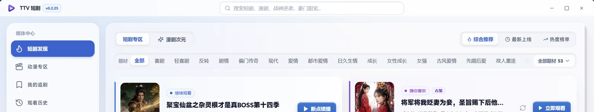
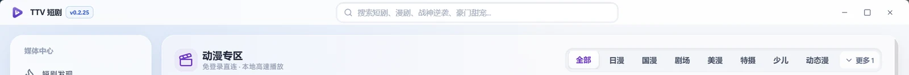
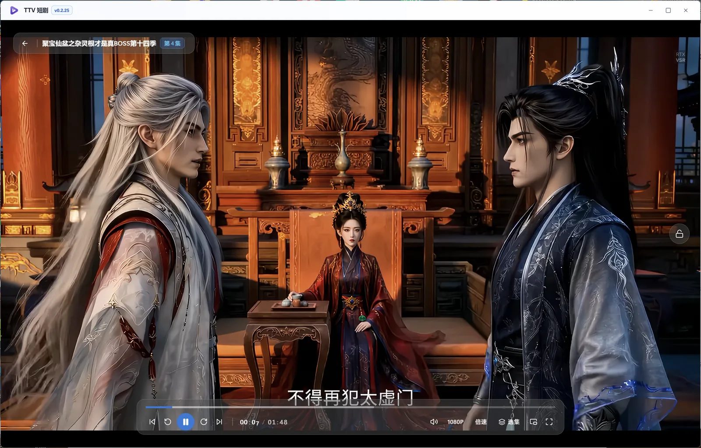
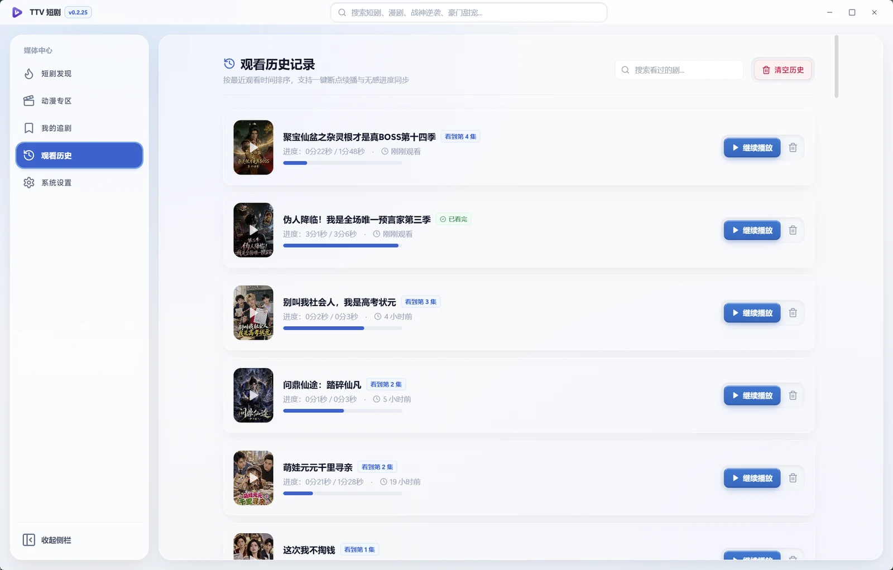
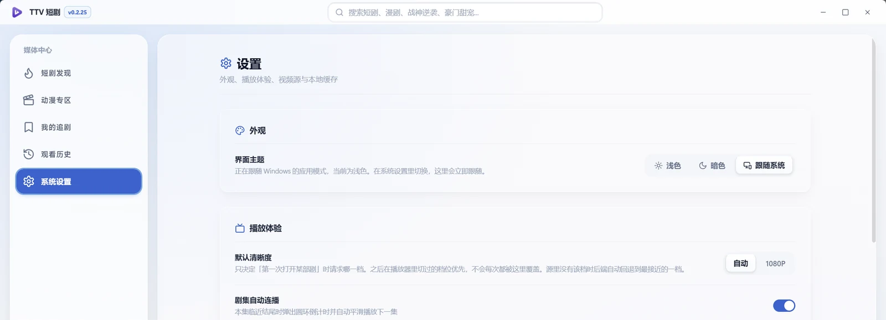

  

<h1 align="center">TTV Short Drama</h1>

  <strong>为 Windows 打造的短剧、漫剧与动漫桌面播放器</strong> 
  一处发现想看的剧，从上次停下的地方接着看。

  
  
  

  

## 想看的剧，在一个地方找到

打开 TTV，短剧、漫剧与动漫都在同一个桌面客户端里。按题材浏览、切换频道、搜索剧名，也可以从热播与上新里随手挑一部。

- **多频道浏览**：短剧、漫剧、动漫各自成区，分类与排序随手切换。
- **搜索与筛选**：输入剧名或题材，快速缩小范围；搜索记录随时找回。
- **剧集详情**：封面、简介、标签与完整选集一目了然，想看哪集点哪集。
- **猜你喜欢**：详情页底部按季接续推荐，看第 5 季就先排后续的 6、7、8 季。
- **追剧与历史**：收藏在追的剧，自动记录观看进度，下次打开直接续播。

  

## 看得舒服，也看得顺手

播放器把常用操作放在画面上，不打断观看。控制栏、选集、清晰度、倍速与全屏都能随手切换。

- **沉浸播放**：无边框窗口与悬浮控制栏，画面就是主角。
- **清晰度与倍速**：按当前剧集可用的档位选择清晰度，自由切换播放速度。
- **自动连播**：本集结束前出现倒计时，平滑进入下一集。
- **键盘操作**：空格暂停、方向键快进快退、`[` / `]` 切集、`F` 全屏。
- **长按加速**：按住方向键临时加速，松开回到原速，不改变播放位置。
- **操作提示**：按快捷键时画面中央即时反馈当前操作（音量百分比、快进落点时间、切到第几集）。
- **画中画小窗**：置顶小窗继续播放，主窗口可以同时浏览其他内容。

  

## 回来时，从上次停下的地方继续

观看记录会自动保存每一部剧看到哪一集、看到哪里。回看、换集或重新打开应用，都不用再找进度。

- **断点续播**：继续播放按钮直接回到上次的位置。
- **观看历史**：按最近观看排序，支持搜索与清理。
- **追剧收藏**：把想追的剧收在一起，更新与进度清楚可见。
- **本地缓存**：看过的剧集留在本机，回看更顺畅；空间不足时自动清理旧缓存。

  

## 按自己的习惯使用

浅色、暗色或跟随系统，播放与缓存偏好都能在设置里调整。

- **主题外观**：浅色、暗色、跟随系统三种选择。
- **播放偏好**：默认清晰度、自动连播与启动音效均可单独开关。
- **存储管理**：查看缓存占用，按需清空缓存。
- **网络诊断**：设置页可检测系统代理与目录链路，定位「目录加载失败」。

  

## 更新下载

应用内即可检查并安装新版本，下载环节针对国内网络做了优化：

- **自动选路**：下载前先检测 GitHub 是否可正常访问 —— 可访问走直连，不可访问或过慢则自动切换国内加速通道。
- **分片并发**：按分片并发拉取安装包，明显快于单连接下载。
- **完整性校验**：下载完成后比对 GitHub 官方公布的 SHA-256，校验不通过会删除文件并提示。
- **两步确认**：下载完成先询问是否关闭程序，确认后再启动安装向导，不打断你手上的事。

## 下载与安装

前往 [GitHub Releases](https://github.com/kiocou/ttv-short-drama/releases) 下载最新版 Windows 安装包，运行后按向导完成安装。支持 Windows 10 / 11 x64。

## 使用说明

- 本应用仅提供播放器与本地管理功能，不存储、不托管、不传播任何视频内容。
- 剧集信息与媒体内容来自第三方，版权归各自权利人所有。
- 请仅将本应用用于个人合法用途，并遵守所在地区的法律法规。

## 许可

见 [`LICENSE`](./LICENSE)。
